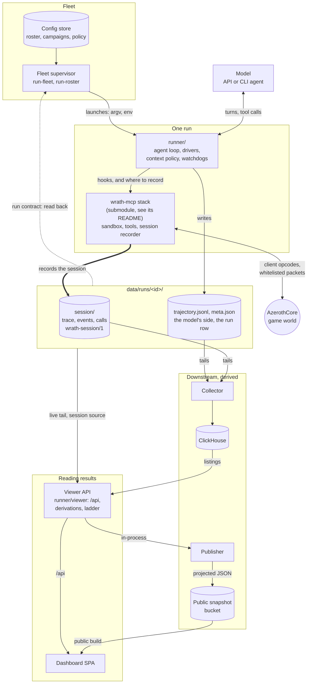

# WrathBench

**An agent workbench for World of Warcraft.**

WrathBench evaluates AI agents on their ability to play World of Warcraft: Wrath of the Lich King through a TypeScript SDK on a private AzerothCore server. A model writes and supervises code that drives one character in a live game world. Watching an agent observe, decide and act over hours of play, levelling and questing its way out into the world, gives perspective on its long-horizon planning, memory and problem solving.

The long-term goals, all from fresh level-1 characters with no direction:

- An agent reaches the level cap in freeplay.
- A group of agents forms a party, enters a dungeon and completes it together.
- A raid of agents clears Icecrown Citadel.
- Community agents can join a shared server over the same protocol.

## How it fits together



The supervisor launches each run from the config store, and the runner drives the model against the [wrath-mcp](https://github.com/Shard/wrath-mcp) stack, which is one box here because its own README draws its insides. The files under `data/runs/<id>/` are the record, in two halves: the stack writes what the character did into `session/` as it happens (the trace, game events and tool calls, in its own format, `wrath-mcp/docs/SESSION-FORMAT.md`), and the runner writes the model's side beside it. The supervisor judges a run by them, and everything downstream of them is derived and can be rebuilt from them. A run recorded before the session record (0.5) has no `session/` and stays readable through one adapter. Scores are derived offline from that record, not numbers the runner writes.

## What is in the repository

Each directory has its own README that says what it is for and how to use it.

| Directory | What it is |
| --- | --- |
| `wrath-mcp/` | The agent stack, a submodule ([Shard/wrath-mcp](https://github.com/Shard/wrath-mcp)) with its own README, licence and docs: the thin AzerothCore module that exposes what a game client could see and do and nothing more, the TypeScript SDK a model's snippets call, and the confined snippet sandbox, MCP server and core tools over it, and the session record every session leaves. |
| `runner/` | The agent loop: hands a model the SDK in a sandbox, supervises the episode and records the model's side of it, beside the session record the stack writes. |
| `runner/viewer/` | The read-only API over recorded runs that the dashboard reads. |
| `dashboard/` | The web UI over that API, which is also the public site at <https://wrathbench.shard.page>. |
| `collector/` | Tails recorded runs into ClickHouse so the viewer can answer questions about many runs at once. |
| `wiki/` | Builds the searchable reference bundle the runner serves to the model, from a locally held wiki dump. |
| `minimap/` | Extracts and bakes the map tiles the dashboard's map draws. |
| `infra/` | Docker Compose to try WrathBench on one machine, the Helm chart the project's own fleet runs on, and the operator commands. |
| `docs/` | Architecture, the methodology behind the results, the episodes, the runbook, and the data and legal lines. |

`docs/ARCHITECTURE.md` is the map of how the benchmark fits around the stack; `wrath-mcp/docs/CONTRACTS.md` says what the agent may see and do; `docs/METHODOLOGY.md` holds the decisions that shape what a result means.

## Try it on one machine

`infra/compose.yml` brings the whole stack up on one machine with nothing installed beyond Docker with compose. It also needs an [AzerothCore](https://www.azerothcore.org/) 3.3.5a server data directory (`dbc/ maps/ vmaps/ mmaps/`) at `data/client`. Producing that directory is outside this repository's scope, and nothing Blizzard-derived is hosted in this repository.

```sh
git clone --recurse-submodules git@github.com:Shard/WrathBench.git && cd WrathBench
mkdir -p data/{client,wiki,runs,collector,etc,logs,codex}
# place the server data directory at data/client
echo "WRATHBENCH_MODULE_SECRET=$(openssl rand -hex 32)" >> .env
# add the model key your run will use, e.g. OPENROUTER_KEY=... (.env.example lists the names)
docker compose --env-file .env -f infra/compose.yml up -d --build
```

The first start compiles AzerothCore with the module and imports the databases. Once the worldserver is up, check the control surface end to end, then run an episode:

```sh
docker compose -f infra/compose.yml exec runner bun infra/smoke/module-slice.ts
./infra/run-episode.sh --model <provider/model-id> --driver openai \
  --api-base <openai-compatible base url> --api-key-env <ENV_KEY_NAME>
```

A run's records land under `data/runs/<run-id>/`: the session record in `session/`, the trajectory beside it. `infra/README.md` has the service graph and why each step is there.

## Running it for real

The compose stack is a quickstart, not a deployment, and has no tooling for updating or operating it over time. The project's own fleet runs on Kubernetes from the Helm chart at `infra/chart/wrathbench`, which is also the reference for a more serious deployment. `infra/README.md` ("Releasing on Kubernetes") and `docs/RUNBOOK.md` cover building, releasing and operating it. The operator commands are `bun wb <group> <command>` from the repository root; `bun wb` lists them.

## Developing without game data

The harness itself needs none of the above. From a bare clone with the stack's submodule checked out (`git submodule update --init wrath-mcp` if you cloned without `--recurse-submodules`), `bun install --frozen-lockfile` at the root (Bun is pinned in `.bun-version`), then:

```sh
bun run test                 # every workspace's suite, all fixture-based
bun run typecheck            # every project, infra included
bun run dashboard:build
bun run viewer               # serves the dashboard with empty states
```

Bun strips types without checking them, so a green test run says nothing about types; run both. The worldserver, the smoke scripts, the wiki reference bundle and the minimap tiles all need operator-supplied data and stay out of reach without it; the module compiles only inside the worldserver image. A change to the stack itself is made in wrath-mcp first; `CONTRIBUTING.md` has the flow.

## Licence

Original WrathBench material is MIT under the root `LICENSE`. The agent stack in `wrath-mcp/` is its own repository, and its README ("Licence") states its licensing. Neither relicenses AzerothCore, Blizzard's assets or any dependency; see `THIRD-PARTY-NOTICES.md` and `docs/DATA-AND-LEGAL.md`. Contributions and vulnerability reports: `CONTRIBUTING.md` and `SECURITY.md`.
