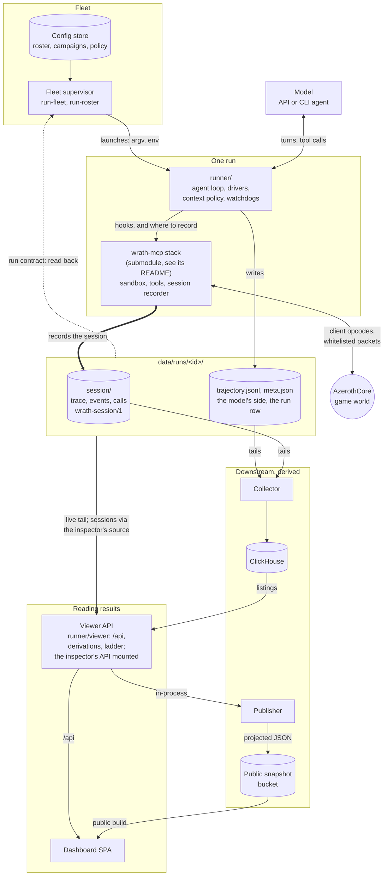

# Architecture

## Components

The supervisor launches each run from the config store, and the runner drives
the model against the stack, which is one box here because wrath-mcp's own
documents draw its insides. What a run spends is modelled and nothing else: a
provider credential with a free slot and room in its budget, and a game
account from one pool (`infra/run-fleet-credentials.ts`; `docs/RUNBOOK.md`,
"Credentials"). Which credential paid decides when a run starts, never what
it measures: it is recorded on the run and kept out of the comparability
tuple. The stack records what the character did into the
run's `session/`; the runner writes the model's side beside it. Everything
downstream of those files is derived.

### Groups

A deployment is made of three groups, and any of them can be switched off
(GitHub issue #427; `runner/viewer/groups.ts`): **runner** (the agent loop, the
drivers, providers and credentials, the fleet supervisor), **evals** (episodes,
campaigns, scoring, the ladder, comparability) and **viewer** (the inspector,
the run pages, the public site). A group that is off is absent, not hidden:
the chart renders none of its workloads, and the processes that remain read
`WRATHBENCH_GROUPS` once at start and mount none of its routes, render none of
its pages and run none of its background work. A viewer-only deployment, for
example, reads the sessions its own agents produced with no supervisor and no
ladder. Which groups are on is deployment config, a chart value, because it
decides which workloads exist, which the config store cannot; the store keeps
deciding what the deployment runs. Switching a group changes what is launched
and shown, never what a result means: with evals off nothing scored is
launched, and nothing is counted differently.

The admin interface sits beside the groups as a switch of its own, off by
default: the viewer's config API, its admin status route and the admin pages,
from which the operator edits credentials, the roster, freeplay agents,
campaigns and the queue. It is one more client of the config store, through
the same validation as the CLI, and private only: the public build never has
it, and a secret's value never passes through it (`docs/RUNBOOK.md`, "The
admin interface").

### The stack and the benchmark

Two layers, deliberately separable. The **stack** is
[wrath-mcp](https://github.com/Shard/wrath-mcp): the AzerothCore module, the
SDK and the MCP surface (snippet sandbox, MCP server, core tools, the session
record), a client-equivalent agent surface over a stock AzerothCore, and
wrath-inspector, which reads the session record back. It
records what its own sessions did and knows nothing of what drove them: the
session record (the trace and character sheet, game events, tool calls and
their results) is the stack's, and it never learns a run id, a turn number, a
score or the wiki. The **benchmark** is this repository: `runner/` with
`infra/`, `wiki/`, `dashboard/`, `collector/` and `minimap/` around it, which
is what turns that surface into a measurement: the fixed loop and the CLI
drivers, the prompt and context policy, its own tools, the model's side of
the record (requests, responses, tokens, cost, turns, compaction), the
watchdogs, the scoring.

How the stack works inside (the module's attachment to the core and its mover,
the SDK, the sandbox and its confinement, hint delivery, one action's path end
to end) is wrath-mcp's
[`docs/ARCHITECTURE.md`](https://github.com/Shard/wrath-mcp/blob/master/docs/ARCHITECTURE.md),
and its specification is `wrath-mcp/docs/CONTRACTS.md` with
`wrath-mcp/module/PROTOCOL.md`. This document covers only what the benchmark
takes from the stack and how.

**How it is consumed.**

- One submodule, `wrath-mcp/`, pins the module, the SDK, the MCP stack and
  the inspector together; `infra/PINS.md` records the pin and the rules for
  moving it. The worldserver image compiles `wrath-mcp/module/` into the
  pinned AzerothCore tree ("infra/", below), and `wrath-mcp/sdk`,
  `wrath-mcp/mcp` and `wrath-mcp/inspector` are workspaces of this repository
  that the runner, the viewer and the dashboard import by package name
  (`@wrathbench/sdk`, `@wrathbench/mcp`, `@wrathbench/inspector`) and in no
  other way.
- The line is enforced on both sides. The stack's `wrath-mcp/scripts/boundary.ts` fails
  when anything in it imports outside itself but a declared dependency;
  `infra/stack-boundary.ts` (`bun run boundary`, also a test and a CI step
  here) fails when anything outside it reaches into stack sources by path,
  when the shared pins disagree (the toolchain, zod, and the UI's Solid and
  Vite, which the dashboard and the inspector's views share), or when the
  AzerothCore commit wrath-mcp's README is tested against is not the one
  `deps/azerothcore` pins.
- The model's SDK reference is the stack's: `wrath-mcp/sdk/API.md`, generated
  from the SDK source. The sandbox exposes its path as `API_MD_PATH` and the
  system prompt tells the model to read it from a snippet, so a pin that
  changes it changes what the model sees (docs/METHODOLOGY.md, "Fixed harness,
  frozen per version").

**The hooks the runner implements**, each a narrow interface of the stack's:

- **Tools** (`wrath-mcp/mcp/src/tools.ts`): one dispatcher, `ToolSet`, serves
  every tool — lenient argument parsing, alias keys, strict validation, the
  unknown-tool answer, the harness-delivered hint block and the secret scrub.
  The stack defines the five core tools (`run_snippet`, `recent_events`,
  `state_summary`, `write_scratchpad`, `edit_scratchpad`); the runner adds its
  four as `ToolSpec`s and lists all nine in the order they are served
  (`runner/src/tools.ts`).
- **Rendering** (`CoreToolRender`): the event line, which events are ambient,
  the state summary and what a snippet result ends with are the harness's
  context rendering (`runner/src/context.ts`, the snippet delta), handed to
  the core tools rather than known by them.
- **The sandbox child** (`SandboxChildExtension`,
  `wrath-mcp/mcp/src/sandbox/child.ts`): the runner's extension
  (`runner/src/sandbox/child-extension.ts`) latches spell marks, the snippet
  delta, the turn's event window and the HUD's fields: what the benchmark
  shows a model. Nothing an extension holds is reachable from a snippet. The
  runner's host (`runner/src/sandbox/host.ts`) subclasses the stack's to drain
  them. What the session leaves on the record is not an extension's: the
  stack's own recorder runs in the same child.
- **Records and secrets**: every dispatcher is handed a secret registry
  (`CoreToolContext.secrets`, the trajectory on a run) and callbacks for what
  it served; the sandbox host takes `onNotice` and `onActions`. Run config,
  ids, the harness stamp, the wiki and the episodic log never enter the stack.
- **The session record** (`SandboxHostOptions.record`,
  `CoreToolContext.record`): the stack records every session it serves
  (`wrath-mcp/docs/SESSION-FORMAT.md`), and the runner hands it a place to
  write, `session/` inside the run directory (`runner/src/session-record.ts`),
  so the evidence is written in place as it happens. The deployment's own
  characters, which the stack's write gate may name in a party row, are the
  ones named by the records of the other runs on the same world (a guid is
  per characters database, so it names a different player on another
  world; a run with no `config.world` is on the shared one), and a party's
  members from the first row: the stager reports each member's character
  guid, the roster writes them into every member's `campaign.json` before
  any launches, and the run's config carries them to the gate
  (`partyOwnGuids`), so a group row written before a sibling's record names
  its character still keeps it. Any other player is never written.
- **Reading it back** (`@wrathbench/inspector`): the viewer reads every
  session through the inspector's source interface. `runner/viewer/runs-source.ts`
  implements it over the runs directory: a v1 run is a session under its run
  id, read with the inspector's store reader, a fan-out run's characters are
  sessions under `<run-id>~<Character>` listed with the run id as their
  group, and a 0.5 run is presented through `legacy05-source.ts` as the v1
  record's rows. The inspector's
  readout makes the packed trace and nearby windows, the movement intentions
  and the party chat the viewer's routes serve, so its codecs are the ones
  the public site publishes. Its API is mounted at `/api/inspector` on a
  private viewer, and the dashboard embeds its views: the unit frame,
  inventory and quest log on the map, the run page and the character page,
  and a v1 run's session events on the run page. The map's session-side
  logic is the inspector's too: the trace player and its clocks, the replay's
  cursor maths and route, the transport's arithmetic, the movement
  intentions, the camera's fit, and the position and track shapes the feeds
  extend (`SessionPosition`, `SessionTrack`), with the track's inventory
  codec. So are the views' stylesheet (`@wrathbench/inspector/views/views.css`,
  imported after the dashboard's own) and the classes it styles. What stays
  here is the benchmark's: the model's side, scoring, the ladder, campaigns,
  the fleet pages, the public projection and publisher, and the map's
  composition: the map page with its live list and play bar, which draw
  models and logos, run ids, replay and party links, reflection status and
  attempts; the map view's maths, which are built on the viewer's world and
  tile-pyramid transforms (`runner/viewer/worldmap.ts`, `tileindex.ts`) and
  key a pip by run; and the minimap and its tooling.

**Versions, as built.** The SDK has its own version (docs/METHODOLOGY.md,
"Fixed harness, frozen per version"), and `@wrathbench/mcp` carries the same
one. The runner depends on the stack at an exact version (`workspace:0.2.0` in
its `package.json`), so an SDK whose version moves fails the install until
that dependency moves with it, and every run records the version in
`meta.json` as `sdkVersion`, beside `harnessVersion`. It is a label only,
outside the comparability tuple and read by no filter. Since two stack commits
can share an SDK version, `meta.json` also records the wrath-mcp commit as
`stackCommit`, a label of the same kind (`stackCommit()` in
`runner/src/version.ts`). The module's wire protocol has an integer version of
its own on `GET /health`, which the SDK checks on `connect` and the runner
checks before a launch or resume (`fetchServerBuild`;
`wrath-mcp/module/PROTOCOL.md`, "Versioning").

### runner/ (Bun/TypeScript, MIT)

- MCP server exposing the model-facing tools: the stack's server and dispatcher over the nine the runner assembles (`runner/src/tools.ts`: the stack's five core tools, rendered the benchmark's way, and its own four). The tool list is fixed and identical for every harness group. The scratchpad has a write tool and an edit tool and no read tool: the pad is injected verbatim into every turn's context already, so `read_scratchpad` was removed (2026-08-30).
- Snippet sandbox: the stack's (`wrath-mcp/mcp/src/sandbox/`), run with the benchmark's child extension. A persistent confined runtime per session, so snippets share state and can leave routines running, with a hard per-snippet timeout. Its environment carries only the run's own leased session secret, never the module's port secret or a provider key. The runner's host adds one directory to what the confined child may read, `runner/`, for its entry and extension; the confinement itself is the stack's ([wrath-mcp's architecture](https://github.com/Shard/wrath-mcp/blob/master/docs/ARCHITECTURE.md#the-sandbox); `runner/README.md`, "The sandbox"), and per-host and non-TCP egress are the deployment's network policy (`docs/RUNBOOK.md`, "Network policy").
- Agent loop: model-agnostic. Fixed prompt, fixed event window and state summary, fixed retry policy. Persists scratchpad and summary so a session can resume after a process failure.
  The loop is the program loop: the model keeps a small file workspace in the run directory (`program/`) whose exported async functions are routines the stack runs and tracks, and it sleeps between wakes the runner decides (`runner/src/wake.ts`). The fixed loop, claude-code and codex run it; pi runs the snippet loop, kept as the legacy arm of probe campaigns, until its program adapter exists (`runner/README.md`, "The program loop").
- Fan-out, by grant: `--max-characters <n> --accounts <a,b,…>` (`RunConfig.fanout`, `runner/src/fanout-run.ts`) lets one run's agent have up to `n` characters in the world at once, on those accounts and one model credential (Shard/wrath-mcp#29). The mechanism is the stack's ([wrath-mcp's architecture](https://github.com/Shard/wrath-mcp/blob/master/docs/ARCHITECTURE.md), "Several characters"): one sandbox child holding a client per character, the roster that leases each character's token, and the tool list a granted client is served. The run adds the grant, a session record per character (`sessions/<Character>/`), and `roster.json` (mode 0600: each character's account and session token), which is what a resume logs the characters back in from. It is served the nine tools with `character` on three of them and the three roster tools after, in the stack's default wording, and its turn context is the stack's roll-up: placeholders, because the benchmark's own rendering and prompt for it are not decided. It is refused for a scored episode other than `deadmines-solo`, a party member and a continuation; on `deadmines-solo` the tuple carries its agents and characters as keys (`comparability.ts`), and elsewhere it is not in the tuple (as a party is not). A scored Deadmines attempt reaches the same launch through a file its id pins (`runner/src/task-episodes.ts`), drawn by the policy rather than a campaign, stamped with its episode and no campaign. The fleet launches one as a party campaign's one-agent arm (`arms[].agents: 1`, docs/EPISODES.md): the job holds every account of the party, as a party's does, but one credential slot and one driver session (`FleetJob.fanout`, `sessionsOf`), the roster stages the party and launches one run on it, and every reader of who holds an account counts each account of a run's grant (`accountsOfRun`, `accountHeldBy`), so a supervisor restart or another job never takes one while the run is live, and its resume waits for all of them. By hand it is still `docs/RUNBOOK.md`, "A fan-out run, by hand". A run with no `fanout` in its config, which is every other run, is served, recorded and torn down exactly as before.
- Watchdogs: idle timeout, no-XP timeout, episode time limit, snippet runaway. Each ends the episode with a named termination reason.
- The run's records, in two halves. The session record is the stack's, written into the run's `session/` ("Persistence", below): the trace, game events, tool calls, the action log and movement intentions. The trajectory log is the runner's: JSONL per run with the model's side, every request and response, snippet and result, every event batch the model saw, token and cost figures, compaction, pauses and the termination. Nothing game-side is in the trajectory: the scorer, the collector and the run page's feed read the session record, and the feed merges its rows into the trajectory's by time, each with the turn in flight joined by timestamp (`runner/viewer/record-feed.ts`). The one event list the trajectory keeps is each turn's context window (`events_served`, `via: "context"`), because it is what the model was shown. A fixed-loop `request` record carries the turn's fresh user message whole and points at the rest of the prompt instead of re-logging it: the system prompt text once per process segment, and the message window as bounds over the `response` and result records already on the file, with the count of its folded messages and a hash of the bytes sent. `runner/src/replay.ts` rebuilds every request from the file alone and fails on any that does not hash to what was sent; the CLI scaffolds' requests keep their own shape (`runner/README.md`, "The request record and the replay").
- Model adapter: one OpenAI-compatible chat layer. Provider and model are run config.
- Drivers (`runner/src/drivers.ts`): `openai`, the fixed loop over the chat adapter; three CLI scaffolds, `claude-code`, `codex` and `pi`; and two that never score, `stub` (a scripted response list, for testing the harness without a model) and `reference` (the scripted reference run, played through `run_snippet`). The driver contract (`runner/README.md`, "The driver contract") says what the runner keeps for every driver, what a driver may vary, and what the trajectory records regardless.

**Harness-delivered hints.** A failed action's recovery hint reaches the model only if the snippet's own code keeps it: one run took 41 `too_far` refusals in four hours while reducing every result to `.status`, and read the hint zero times. So the stack's dispatcher also delivers each hint-bearing failure at the foot of the next tool result of any kind, on a channel the snippet cannot strip ([wrath-mcp's architecture](https://github.com/Shard/wrath-mcp/blob/master/docs/ARCHITECTURE.md#harness-delivered-hints); docs/METHODOLOGY.md, "The model surface"). It goes in the tool result rather than the next turn's harness-notice block because a claude-code turn is a whole CLI session: a notice there would arrive a turn late, and delivery must not cost the model a follow-up inspection. Every driver dispatches through the same `callTool`, so every driver gets it, and the trajectory's `snippet_result` or `tool_result` records it as part of what the model saw.

**The action log.** A snippet's code says what the model asked for; it does not say what went on the wire — a helper's inner `set_target`, a routine's fortieth re-cast, the refusal the snippet swallowed. So the stack's sandbox watches its own client's `POST /action` requests (the same fetch the move intention is read from) and the host writes each dispatch, with the module's HTTP answer, to the session record's `calls` stream. The run page's feed reads it there, as the `actions` record shape the 0.5 trajectory carried: action name, the body with the token stripped, status, error code and hint on a refusal, the `move_to` move id, timing, and the client-cache names the session already held for the ids (unit, spell, item, quest). One record per snippet, flushed just before its result, rather than one per action: about ten dispatches per snippet would otherwise push the snippets out of the feed's 200-record window. A background routine's dispatches between snippets flush on a 60-second idle timer and are marked `routine`, so the record count is one per snippet that dispatched anything plus at most one a minute of routine activity between snippets; identical consecutive dispatches fold into a count, and past 120 notes per flush the rest are counted by action name, because a looping routine has dispatched millions. The record's `callTs` is the owning `tool_call`'s `dispatchTs`, which is the join: the CLI drivers append the call after it ran and the fixed loop before, so position cannot be. It records the dispatch and the module's answer and nothing more — a `200` is "queued", and what the game made of it is on the event stream, with a `move_to`'s verdict in the `move` row of the same move id (the session record's `calls` stream). Nothing in it reaches the model. The module's audit log is the ground truth for the wire while it is kept, which is a few days (wrath-mcp/docs/CONTRACTS.md "Audit"); this record is the one that stays with the run, attributed to the snippet that caused it. Size, on a long freeplay run of about 9,600 snippets over 51 hours with a 104 MB trajectory: by its snippet code, about half its snippets call a dispatching helper and one in twelve launches a routine, so the records add at most about 9,600 lines to the 65,000 it has; by the module audit logs of earlier long runs, which dispatched 1,300–2,200 HTTP actions an hour, the notes come to roughly 70k–110k at about 100 bytes each, so 7–15 MB more, about a tenth.

**Reflection, the episodic log, and the trim notices.** Three of the tools
exist because of the message window rather than the world (docs/METHODOLOGY.md,
"Reflection is the model's to take, and only at rest or in flight" and "An
episodic log, asked for at each trim or compaction, read back at rest or in
flight").
`log_status` appends one harness-stamped entry (turn, level, zone) to
`data/runs/<id>/episodic.jsonl`, which is append-only and therefore not the
scratchpad. `reflect` returns a fixed, content-free review prompt while the
character's `resting` or `taxiFlight` flag is set — one reflection per rest
visit and one per flight, each armed by its own flag turning on — and opens a
reflection window in which `read_log` pages that log, newest first unless
asked for `order: "oldest"`, optionally filtered to a level range or a zone
(`formatPage` in `runner/src/episodic.ts`); the window closes when
the rest visit or flight it was granted in ends (`left_rest` or `landed`), on
a circuit breaker, or at the end of the run, and every transition is a
`reflect_window` record. After a sandbox restart the state cache is rebuilt
from the module's reattach replay (wrath-mcp/module/PROTOCOL.md, "/events"), whose own
create block carries both flags; until it lands they are unobserved, and the
gate holds the last reading of each
rather than reading silence as "not resting" or "not flying" — the same latch
discipline the ghost flag has.

The fixed loop asks for an entry (`trim_pending`) on the last turn before a
block trim and says so afterwards (`window_trimmed`, with how many older tool
results the same trim folded to one-line records; `runner/README.md`, "The
context, the prompt and the scratchpad tools"). That is exact rather than
predicted: a turn's message count is not known until the model has answered it,
so the cut is applied one turn *after* the crossing that earns it
(`laggedLength`), which turns an unanswerable question about the future into a
fact already sitting in the history. Every trim is preceded by exactly one
prompt, on the turn immediately before it, whatever the model's tool-call count
does; the price is that the window sits at most one turn's growth above
`MESSAGE_WINDOW_MAX` for that one turn, and the prefix stays byte-stable
because the cut, and the fold boundary with it, still moves only in whole
blocks.

The CLI drivers run no message window of ours, so they never raise either
trim notice and fold nothing; what loses their context is the CLI's own compaction, and that is
what they ask on (`runner/src/cli-compaction.ts`). Neither CLI says ahead of
time when it will compact, so at each turn boundary the driver compares the
context the CLI last reported against the CLI's auto-compaction threshold —
derived from the window it reports, by the pinned CLI's rule, and capped by
the lowest context this run has actually been compacted at — and asks
(`compaction_pending`) once the context plus two turns of the cycle's largest
per-turn growth reaches it. A compaction that no ask preceded is asked about on
the next turn instead (`compacted`). One ask per cycle between compactions.
Codex turns are short — one `codex exec`, a few calls — and the Codex CLI
compacts after a turn's first call, so the prediction lands a turn ahead; a
claude-code turn can run for hours, and a notice reaches the model only at a
turn boundary, so there the after-ask is common. Each compaction is also a
`harness` record of kind `compaction` (`CompactionRecord`): token counts
before and after, when and how long, and the summary the CLI produced — off
the Claude Code session transcript, while the Codex CLI on a ChatGPT login
compacts remotely into an encrypted item, so its record says so and lists the
turns whose context messages it kept verbatim instead. The record is
trajectory only; the public projection passes its token counts and duration,
never the summary. The tool list is identical on every harness — a tool that
appeared on one and not the other would be a second, quieter difference — and
one claude-code CLI session can be one long driver turn, which puts the
reflection breaker far out of reach there. The standalone MCP server (`runner/src/mcp.ts`,
an operator's hand-driven mode) has no context builder at all, so nothing there
could ever observe the character leaving or landing, or count a turn: it answers `reflect`
and refuses `read_log` rather than serving the log through a window that could
never close.

### runner/viewer/ + dashboard/ (Bun/TypeScript, MIT)

The operator's window on runs, live and finished: read-only, except the
config API the admin switch mounts. Split in two along
one line: the Bun process owns everything that needs the filesystem,
the SPA owns everything that is UI.

- `runner/viewer/` serves a read-only JSON API under `/api`, an SSE tail per
  run, the inspector's API at `/api/inspector` (the session record unprojected,
  so a public handle withholds it whole; its id reads as the session's id
  there, the run id or `<run-id>~<Character>`, never as the token's
  fingerprint), minimap tiles from `data/minimap/` (the native tiles, the
  downsampled levels baked from them, and the painted world-map art baked
  onto the same grid, each served from a smaller transcoded copy of the
  lossless masters), and the built SPA as static files. Every database is
  opened readonly, so a run being written inside the container is never
  disturbed. Bearer tokens are stripped from anything that forwards a raw
  record. `WRATHBENCH_VIEWER_PUBLIC=1` withholds raw entries and tiles — the
  unprojected record and Blizzard bytes — and serves entry summaries through
  the public projection and the game-prose redactor (`runner/viewer/README.md`).
  `WRATHBENCH_VIEWER_TILES_PUBLIC=1` opts tiles alone back in for a deployment
  whose operator has decided it may serve them; the static public
  snapshot never carries a tile either way.
- `dashboard/` is a SolidJS SPA and the only UI. The homepage shows the tools
  as served by `/api/tools`, so the page cannot drift from the runner. The map
  view draws minimap tiles decoded from the client's own MPQs into
  `data/minimap/` (gitignored) on plain canvas behind a position-feed interface,
  so replay can later plug a trajectory reader into the renderer that serves
  live runs. Zoomed out it draws a level of a pyramid baked from those tiles
  instead, chosen per frame so the cells on screen stay near tile size and
  inside the page's tile cache. That is what lets a continent overview show
  ground rather than an empty grid, and the cached level above a cell is
  drawn under it while it loads. The levels sit under a layer directory
  (`<map>/minimap/<z>/`), and the painted world and zone map shares them as
  a second layer (`<map>/art/<z>/`). The page lays the art over the minimap
  and crossfades the two by screen pixels per ADT: the painted map reads as a
  map at continent scale, and the minimap is the ground a character walks on
  up close. Where the art has nothing, the minimap shows at full strength
  (`minimap/README.md`, `dashboard/src/lib/mapview.ts`). It imports modules from the viewer rather than copying them, so
  drift between the two sides is a compile error, and the session-side views
  and codecs from the inspector (`@wrathbench/inspector/views`, `…/codec/*`).
  It and the inspector are the only places with a UI dependency graph, pinned
  alike; the harness itself still runs with no build step. Without a build on disk there is no fallback UI.
- **A resolved model id is shown only where it differs.** A run is launched
  with the string the roster named, which under the claude-code harness is
  usually an alias the CLI resolves minutes later to a real id; the resolved id
  is recorded on first observation and never revised (docs/METHODOLOGY.md,
  "Episodes, lanes, and evidence"). The pages show it only where it differs
  from what was asked for, and flag a roster model that resolved to more than
  one id across its runs, because that drift is the thing the field exists to
  make visible. Runs that predate the field are back-filled at read time from
  their own trajectories and never written back.
- **One page per grain, and the runs have their own.** The fleet page is what
  is running *now* and links to a run without listing them; `/runs` is the runs
  — one row per recorded run of every kind; `/about` is the tiers, listing no
  runs of its own;
  `/ladder` is the aggregates. Runs are listed in one place and one only — a
  page that opens with most of its rows filtered away is not that place — so
  `/results` redirects to `/runs` with its query intact, and there is no
  cost-per-level chart: the ladder's own columns already say how far each model
  got, and a cost view worth having is a page with its own reason, not a chart
  smuggled onto another one.
- **Every run belongs to a character, and the character has a page.** A durable
  freeplay character is one character across attempts, and everything the runner
  records is per attempt — so a reader could see only the session in front of
  them and the quest count was the last session's. The viewer aggregates the
  chain at read time (`runner/viewer/character.ts`) and the run page leads with
  it. The feed stays per attempt because a trajectory is one run's, with a link
  at each seam. The character is also a page of its own, `/character/<id>`. It is **universal, not freeplay-only**: a scored run's character
  is a chain of one attempt, so no page branches on "is this freeplay" to know a
  run has a character. Navigation stays freeplay-first — freeplay rows lead to
  the character, scored rows to the run. Nothing is written back: the record is
  per attempt and stays that way, which is also why an attempt predating a column
  contributes nothing rather than a zero.
- **A party attempt is one thing, and has a page and a replay.** A Deadmines
  party is five runs launched, stopped and counted together
  (docs/proposals/GROUP-PLAY.md), and listed as five unrelated rows it read as
  five attempts. Membership is the stamp each member's run carries
  (`config.party`), never a parse of a run id. `/party/<id>` is the members and
  one timeline merged across them, and `/map?party=<id>` replays all five on one
  clock, each in its own colour, the map following one member while the
  sidebar says where the others are. Like the character page, both are built in
  the browser from the listing and each member's run detail, which carries that
  member's own records (`runner/viewer/party-marks.ts`); there is no party
  route, so the private viewer and the public bucket run one derivation.
- **The harness series is one shell-wide filter, not a per-page control.** The
  series — `major.minor` of a version stamp — is already the comparability
  group every page of runs is a view of, so the selector lives once, in the top
  bar, and filters every page that shows runs. Four pickers that could disagree
  about what a shared link meant is the failure the episode filter was
  consolidated to prevent. `latest` is stored as the token rather than the
  series it resolves to today, so it follows a minor bump instead of freezing;
  the newest series also appears under its own number, because `latest` tracks
  and a number pins. The choice lives in `?series=` so a link is shareable and
  in `localStorage` so a tab reopens where it was, URL first. A run whose stamp
  names no series belongs to no group and appears only under `all`. Filtering is client-side over rows the API already carries,
  with `/api/info` (the route the shell already polls) naming the series that
  have runs, rather than a poller or a route parameter per control. Three pages
  are deliberately unfiltered: the fleet page is the deployed series by
  construction, the models page is the scheduler's verdict computed
  server-side, where a client-side filter would make the counts and the list
  disagree, and the map is a picture of who is playing now rather than a set
  of results to compare, so it shows every live character whatever its
  harness and the shell does not draw the selector on it. This is a different dimension from the harness filter, which
  selects which *loop* owned a run; both exist and compose, which is why this
  one is spelled `series` everywhere. The ladder offers no harness control at
  all: there the harness is a tag on each row and a colour on each point, not a
  partition.
- **`infra/model-catalogue.json` is the one place a model's static facts
  live; the fleet config stays a scheduling catalog** (operator, 2026-10-20).
  Every model id the fleet has used has an entry, keyed by the id it ran as:
  its family (which carries the logo, the brand name and the company), its
  display name, whether its weights are published (`open`, `closed` or
  `unknown`, with where that was checked), the other spellings it goes by (a
  codex slug, a dated snapshot, a Zen `-free` id, the id a provider reported
  serving), and every price a provider charges for it. `infra/model-catalogue.ts`
  is the whole of the code that reads it — lookup, types, the validator and the
  file's one spelling — and the runner (bundled into its image whole), the
  dashboard build and the infra scripts all import it, so nothing else keeps a
  per-model table. The dashboard bundle gets only the fields the lookup reads
  (`dashboard/src/lib/catalogue-subset.ts`, swapped in by its Vite config at
  each build), since the prices and notes were most of a page's bytes. JSON rather than a TypeScript module because a script writes
  part of it: `bun wb data prices` rewrites each model's OpenRouter windows in
  place, and a data file is what a script can rewrite without touching the
  hand-kept facts beside them; the module adds the types and the comments a
  JSON file cannot carry.
  Every roster field in the fleet config is a scheduling fact and presentation
  has always been absent from its schema, so a roster entry names a catalogue
  model by its id and nothing more. Lookup is data-driven and dumb on purpose:
  an id is compared lowercased and without OpenRouter's `:free` suffix, against
  the entry keys and their aliases; an id no entry lists falls back to the
  first family whose glob claims it (file order is precedence), so a model
  nobody has catalogued yet still gets its vendor's mark, and one nothing
  claims gets a neutral monogram rather than a special case in code, which is
  the per-model override the harness forbids. That fallback is where a new
  model must not live: the tests refuse any id in the repository's fixtures,
  roster example or price rows that only reaches it, `--status` names roster
  entries that do, and `bun wb data catalogue` asks the same of a published
  generation. Recognizing a new model is a data edit, never a code change, and
  the mark appears wherever a model is the row.
  Weights are per model because a family spans both kinds (Gemini and Gemma,
  GPT and gpt-oss), so an entry states its own; a family may state one for all
  its models only where the company publishes no weights at all (Anthropic).
  The ladder's weights filter and the Every Eval Ever export's
  `model_availability` both read it through `weightsOf`, and the ladder's
  company filter is the family's company. The ladder's *family* filter is the
  model line, a rule over the slug (`lineOf`), not a catalogue field: it must
  answer the same for an id nobody has catalogued as for one somebody has.
  Prices are matched on the id the provider bills under, exactly, never
  through an alias, because the same model is different money on different
  hosts: OpenRouter's synced windows by OpenRouter id, Anthropic's list prices
  by the served ids, a metered endpoint's by its base and id
  (`runner/viewer/pricing.ts` holds the rules for which row a run reads, and no
  rate). Two things stay rules rather than catalogue rows, because they judge
  the shape of an id nobody has seen: the scheduler's Claude-family test
  (`isClaudeFamily`) and the free, contributor and local billing predicates;
  so does `LAB_PROVIDERS` (`runner/src/routing.ts`), which is routing policy
  keyed by an OpenRouter namespace and is stamped into the comparability tuple.
  The repository keeps no context-window table: the CLI drivers take the
  window from their own catalogues. Logos are fetched rather than drawn:
  `infra/fetch-model-logos.ts` pulls the npm tarball of the Lobe Icons package
  at the version pinned in the catalogue's own `icons` block and extracts
  exactly the icons its families name; the SVGs are committed, because they are
  a few hundred bytes each and the dashboard has to build from a bare clone
  with no network. The dashboard draws them from one sprite the fetch
  generates from those files (`dashboard/src/lib/logosprite.ts`), fetched once
  rather than inlined into every badge. The artwork is MIT-licensed and the brands remain their
  owners' trademarks; provenance is in `THIRD-PARTY-NOTICES.md`.
- Loopback by default. Trajectories carry game-derived text, so a non-loopback
  bind fails at startup unless `WRATHBENCH_VIEWER_LAN=1` opts a trusted private
  network in (docs/DATA-AND-LEGAL.md). What a public deployment may carry is
  docs/DATA-AND-LEGAL.md's to settle.
- **Public hosting is push-based, so the lab is never an origin.**
  `infra/publish-dashboard.ts` calls the viewer's own `createApi` handler
  in-process, applies an allowlist projection, and PUTs generation-addressed
  JSON to a bucket on a timer (R2 here, any S3-compatible one by
  configuration), manifest last so a reader never
  observes a torn generation; every public read is then a static asset or an
  edge-cached object and no inbound path to the harness exists at all. The SPA
  builds a second time in **snapshot mode** — a build-time
  `VITE_WRATHBENCH_SNAPSHOT_BASE` selects a client implementing the same
  `Client` interface over the bucket instead of `/api`, so the pages are the
  same pages and the private build keeps its same-origin, CORS-free posture.
  A deployment may also hold the public view back by a delay, publish only the
  current view without the run history, or publish nothing
  (`docs/RUNBOOK.md`, "Where it publishes, and how").
  Design and cost model are docs/PUBLIC-DASHBOARD.md, the Cloudflare setup is
  infra/cloudflare/README.md, and the gate above still binds.

### wiki/ (Bun/TypeScript, MIT)

Tooling to turn a locally held wiki dump into a searchable bundle the runner can serve. The dump and the bundle live in `data/` and are never committed.

### minimap/ (Bun/TypeScript, MIT)

Tooling for local map assets used by the viewer: the extractor that decodes the client's minimap tiles and the bake that downsamples them into the zoomed-out levels. The assets themselves are supplied outside the repository under `data/` and are not part of the MIT-licensed WrathBench source.

### infra/

The images (`infra/docker/`) and two ways to run them. The Helm chart (`infra/chart/wrathbench`) is how the fleet runs and the reference for a real deployment; its release and deploy scripts are `infra/k8s-release.sh` and `infra/k8s-deploy.sh`. `infra/compose.yml` brings the same services up on one machine as a quickstart, with no deploy or update path of its own, because nothing is operated on it over time. The server data directory is supplied by the operator under `data/`. The smoke scripts under `infra/smoke/` drive the module end to end through the SDK.

The core is stock AzerothCore, pinned by commit — no playerbots fork, so there
is one dependency tree. A party's members are agents too: five loops of one
model, a character each (`docs/proposals/GROUP-PLAY.md`), not server-side bots.

The worldserver image (`infra/docker/server.Dockerfile`) is a close adaptation of upstream AzerothCore's own multi-stage Dockerfile with the build context at our repo root: it copies the pinned submodule plus `wrath-mcp/module/` as `modules/mod-wrathbench` and keeps upstream's stage names, base image, toolchain, runtime user and filesystem layout, so upstream docker fixes diff cleanly against ours at each submodule bump. Two departures: `-DWITHOUT_GIT=1`, because a submodule checkout has no usable `.git` (version strings read `unknown`; the submodule pointer and `infra/PINS.md` are the pin), and a 10G ccache mount, because upstream's 1G thrashes on a full core build and module iteration is the hot path. RelWithDebInfo is kept because symbols matter when the module crashes the worldserver. A `db-import` target is built alongside because upstream's boot flow expects it.

## Data flow for one action

One action's path through the stack, from `run_snippet` to the opcode the module dispatches and the packets it taps back, is [wrath-mcp's architecture](https://github.com/Shard/wrath-mcp/blob/master/docs/ARCHITECTURE.md#data-flow-for-one-action). The benchmark is at both ends: the runner serves the call through its tool set, its rendering and its child extension, and appends the snippet, its result, the actions it dispatched and the events the model was shown to the trajectory.

## Launching a run: the run contract

The supervisor (`infra/run-fleet.ts`, one `infra/run-roster.ts` per job) and
the thing it launches (`runner/src/run.ts`) talk only through argv, a few
environment variables and the files under `data/runs/<id>/`. That is the
contract; it is what lets a probe-campaign arm run a different container image
— a branch build, or a harness that is not this repository at all — without
the supervisor knowing anything about its insides. `infra/episode-launcher.ts`
is the one interface a roster starts an episode through, with two
implementations: today's child process, and a Kubernetes pod
(`infra/run-pod.ts`) created from the chart's template. Everything the roster
does around an episode — session hygiene, classification, retries, the defer
ladder, credential accounting — reads the files below and never the handle, so it is
the same for both.

**What the supervisor passes.** The flags `episodeFlags` builds
(`infra/run-roster.ts`): on a fresh launch `--driver`, `--model`, `--run-id`,
the run's credential by id and env var *name* (`--credential`, and `--api-key-env` or
`--credential-env`, with `--usage-max-pct` for a usage budget),
`--account`, `--effort`, `--compact-window`, the lane's leash
(`--episode-ms`, `--max-tool-calls`, `--watchdogs-json`), and for a probe
`--episode probing --campaign-file <runs/id/campaign.json> --ref <name>`
followed by the arm's own args verbatim; on a resume only `--resume <id>` and
the leash, because identity is the stored run's. `campaign.json` is written
before the launch and is the whole shape the run follows: campaign, version,
hash, source, cell, arm and the definition itself (`runner/src/campaign-file.ts`). The environment carries
`WRATHBENCH_HARNESS_VERSION` (the image's tag — an arm's own, never master's
when the arm pinned one; a digest-only pin stamps
`<repository basename>@sha256:<12 hex>`, which names no series),
`WRATHBENCH_RUN_IMAGE` (the image as requested, when the episode is a pod),
`WRATHBENCH_MODULE_URL`, `WRATHBENCH_RUNS_DIR`, `WRATHBENCH_IN_CONTAINER=1`,
`WRATHBENCH_LOCAL_MODEL_HOSTS` (the self-hosted hosts the provider table pairs
with `LMSTUDIO_KEY`, which run.ts checks the key and base against before it
reads the key), the module port secret, and the one credential the driver
bills: its credential's `CLAUDE_CODE_OAUTH_TOKEN*` for claude-code, its key
for openai and pi, the mounted `CODEX_HOME` for codex. A key or token the
config store holds arrives instead as `WRATHBENCH_SEALED_SECRET`, with
`WRATHBENCH_STORE_KEY` by reference, and a harness opens it into its variable
and drops both before anything reads its environment
(`runner/src/store-secrets.ts`, `unsealLaunchSecret`). Nothing else: no database variables, no config
store, and no `ANTHROPIC_*` variable ever (claude-code is subscription-only;
the pod env builder refuses to build a pod that would carry one). The run
directory is on a shared volume. Before the run starts it holds at most launch
files — a probe's `campaign.json`, a pod's `image.json`, the pointer to its
own world `world.json` (`{ "id" }`, with the world's module URL in
`WRATHBENCH_MODULE_URL`), which run.ts stamps as `config.world` at a fresh
launch (`shared` without one) — and a directory
holding only those is not a run: a fresh launch onto it proceeds and
overwrites them, where anything else there refuses the launch.

**What it reads back** (`readRunFact`, `runner/src/models.ts`, is the
reference reader). `meta.json`: `harnessVersion`, `startedAt`,
`config.{model, effort, compactWindow, account, character, token, campaign,
campaignVersion, cell, arm, ref, credential, extra, watchdogs, world}`,
`comparability.{episode, episodeOverride, effort, compactWindow}` and, while
paused, `pause.{reason, at, episodeElapsedMs, notBefore}`. Beside those,
meta.json holds the run row: `termination.{reason, detail}`, `endedAt` and
`pauseReason` are how the roster classifies an exit — a termination is done,
a pause is resumable or a failed attempt by the lane's rule, neither is
"unknown", and no run at all is a failed launch (for a fleet probe, the
roster then writes a stub meta.json terminated `launch-failed`, so the
attempt counts toward its square's cap). The level it reports is the session
record's (`runner/src/run-reader.ts`). A termination is appended to the
trajectory before meta.json is rewritten, so when meta.json has none and the
run has no pause and no live owner, the trajectory's last `termination`
record is the verdict, and the supervisor writes it into meta.json; a `pause`
record there, or meta.json's pause mark, is the pause, unless a `resume`
follows it. meta.json is rewritten whole, through a temporary file renamed
into place, so a reader never sees half of one. A 0.5 run kept its row in
`run.sqlite` instead, which `run-reader.ts` still reads (`runner/src/rundb.ts`).
`heartbeat`, one small file rewritten
every 20 seconds and removed on a clean exit, is the only proof of a live
owner: a resume onto a run with a fresh one is refused, and an account is held
by a run whose heartbeat is fresh however quiet its trajectory. The
trajectory's `response` records count the attempt's turns. A pod also leaves
`image.json` (`ref`, `digest`, `pod`, `node`, `startedAt`), written by the
launcher when the container starts, and a resume in a pod relaunches that
digest whatever the arm says now; a resume while run pods are off is a child
process on the release, so only a probe with `image.json` and run pods on is
exempt from the harness-series gate. The supervisor keeps the facts it reads
for terminated runs in `data/runs/run-facts.cache.json`, keyed by the size,
mtime and inode of every file above (not ctime, which the fleet pod's fsGroup
chown moves at every start) and by the reader's own source, so a boot reads in full only
the runs that have not ended; any doubt about an entry is a cold read, and
deleting the file costs one. `--status` and `--dry-run` read the same file
read-only and never write it, so a report beside the supervisor counts only
the live, paused and verdict-less trajectories. After a release that changes
the reader, a report reads cold until the new supervisor's first tick
rewrites the file.

**Signals and exit codes.** SIGTERM is the supervisor's: the run writes its
`operator-pause` row synchronously, then unwinds, and exits within 60 seconds;
the launcher gives it 90 (`EPISODE_TERM_GRACE_MS`, the pod's
`terminationGracePeriodSeconds`), inside the fleet pod's 180. SIGINT is an
operator's cut and ends the run `manual`. Exit 2 is a refusal before anything
was written (an unknown or repeated flag, a campaign file that does not hold
together, a missing credential, a run id already on disk); 75 is
a resume refused because the run has a live owner; 130 is a signalled exit.
Any other code is read through the run row, never on its own.

**A party's end, asked rather than signalled.** When a party member's run
ends on its definition's end, the roster writes `end-request.json`
(`reason`, an end reason; `detail`, `<member>: <reason>`; `at`) into each
other member's run directory instead of sending SIGTERM, which would pause it
and kill a CLI before its closing result. The runner polls for the file every
two seconds, ignores one older than its own process segment, and ends on it
through its watchdogs, so the driver winds down exactly as on its own end and
records its result (`runner/src/end-request.ts`). A member still running two
minutes later is sent SIGTERM and ended by the roster as before, which is also
all a harness that ignores the file ever sees.

**A harness that is not this runner** is launched the same way: an arm names
`image` and `command`, the pod runs that command with the flags above as its
args and the volumes, env and secrets of a run pod, and is judged by the files
it leaves. It has to accept the flags it is given (or refuse with exit 2), keep
a heartbeat, write `meta.json` and the `run` row, pause on SIGTERM within the
grace, and record its own turns as `response` records if it wants them
counted. To land in its campaign square it stamps `config.{campaign,
campaignVersion, cell, arm}` from its `campaign.json` and `config.ref` from
`--ref`; a campaign's work is counted by those stamps and nothing else. It
names itself as the `external` harness (`config.driver: "external"`, and a
tuple, if it writes one, with `harness: "external"` and the `agent` it is,
`{ name, version }`), which keeps it in a comparability group of its own,
never ranked with ours (operator, 2026-11-14); a field it cannot state is
null, never a guess. The hand-driven stdio server (`runner/src/mcp.ts`) stamps
its runs the same way from `--agent-name`, `--agent-version` and `--model`. A
runner image older than `--campaign-file` and the strict flag parser cannot
be an arm: it would ignore the file it is given. The viewer and the collector read the same files, so a run that
honours the contract appears everywhere a run appears.

**Run pods.** An episode is a pod only when the fleet setting `policy.runPods`
is `probes`, the supervisor is on the cluster, and the planner put `launch` on
the spec — which it does for every probing job, image-less arms included, so
arms compare on one execution path; scored lanes stay child processes until a
campaign has proven the launcher. An arm that pins an image or a command off
the cluster or with the switch off is a refused pair, never scheduled and
never run on master's code instead. The pod carries an
ownerReference to the fleet pod, so a fleet stop or crash deletes its run pods
with the same grace; the fleet's drain counts a roster's run pod as an episode
in flight, and `infra/k8s-deploy.sh` waits for zero run pods before the
worldserver is touched. Images are admitted by repository
(`runPods.allowedImages` in the chart), tagged or digest-pinned, never
`latest`. Operations: `docs/RUNBOOK.md`, "Run pods".

**Worlds.** A world is its state, a characters schema and a realm row, with
a worldserver pod as a stateless process over it. The long-lived world (the
`worldserver` Deployment) is shared by freeplay. A world per eval is a pod
the fleet creates from the chart's `world.json` template, beside the run-pod
template, and owns like a run pod. The pod shares the game data, auth, the
client data and the confs (read-only) with the long-lived world, and keeps
its own characters schema, realm id and account allowlist. The template
carries none of the three, and the launcher refuses a pod that does not
carry all three of its own (`infra/world.ts`, `buildWorldPod`): an absent
one would fall back to the shared conf's. The roster makes a world for a
fresh scored or probing attempt while `policy.worlds` is `evals`, and ends it
at the attempt's verdict or parks it while a run may resume. Its
address is `http://<id>.worlds:8086` under the headless `worlds` Service,
stable across a boot onto a new pod, because a resume reuses the module URL
its fresh launch stored. Its db-import init creates the schema, or brings a
kept one up to date. A world's own record and its saved console log live
under `data/worlds/<id>/`, outside `runs/`. The chart block is `worlds`, off
by default, and `infra/k8s-deploy.sh` waits for zero world pods after the
run pods.

## Reset

Every episode starts with a freshly created character at level 1 in its starting zone. Character creation is a client action the module supports. Character snapshots (DB save and restore for mid-level starts) are deferred.

## Persistence

- The session record, `data/runs/<id>/session/`: what the character did, in
  the stack's format (`wrath-mcp/docs/SESSION-FORMAT.md`, `wrath-session/1`).
  Append-only, UTC-aligned, five-minute JSONL segments per stream, each
  opening with a key row so it decodes alone and compressed with zstd once it
  closes; `session.json` says whose it is, `live.json` its last reading, and
  `manifest.json`, written when the session closes, lists every segment with
  its size and hash.
  - `trace/`: the character's own position at observation cadence (about 1 Hz
    while moving), its state on change and its character sheet (money, what
    is worn and carried, the quest log's counters, reputation, skills,
    turn-ins) as increments, and the lines it said in chat as the server
    echoed them. It is the record of level, XP, money, position and gear.
  - `events/`: zone, level, deaths, flights, the party records, turn-ins,
    achievements, spells, talents, trades.
  - `calls/`: tool calls and results, the action log, movement intentions and
    the event batches a call served.
  The stack's recorder runs in the sandbox child off the SDK's own cache and
  event stream, and the stack's host drains it into a writer the runner
  opened on that directory (`runner/src/session-record.ts`), so it is written
  in place and the same on every driver. The session is named by a
  fingerprint of its token, the name the module's audit files use, and no
  file of it holds the token. Record only: the model sees none of it. A
  player who is not one of the deployment's own sessions is never written.
- The run's own bookkeeping in `meta.json`: its config and stamps, and the
  run row beside them (the verdict, when it was reached, a pause standing and
  an open reflection window), rewritten whole and atomically. A v1 run has no
  `run.sqlite`. Its level curve, XP, money, quests and position are the
  trace's, folded into samples by `runner/src/trace-samples.ts` (one at each
  change of a scored reading and at every key row), and its milestones are
  the session record's `events` (decision 3 of wrath-mcp#29,
  docs/METHODOLOGY.md, "Scoring").
- Trajectories as JSONL next to it: the model's side of the run, and nothing
  of the game's.
- A fan-out run, one agent driving several characters, has no `session/`: each
  character's record is its own `data/runs/<id>/sessions/<Character>/`,
  named as the server spells the character, beside one model-side
  trajectory, and the launch's `meta.json` says so (`config.fanout`). Its
  `roster.json` holds the characters' session tokens; only the runner reads
  it back, on a resume. Each character is read as a v1 run is, under its
  session id `<id>~<Character>` (`~` never occurs in a run id): the viewer
  serves it as a session of its own and its replay feed under that id
  (`runner/viewer/README.md`, "A fan-out run's characters"), and the
  collector keys its state, move and milestone rows by it, so no table
  needed a new key. No one character's curve, money or milestones are the
  run's, so the run's own samples read empty and its latest reading, which a
  resume tells the model, null (`runner/src/run-reader.ts`). Where a reader
  needs one figure, the listing's level and the scheduler's best level, it
  takes the lead: the character with the highest level, its xp beside it.
  The public site never publishes the run. A run has one layout or the
  other, never both.
- A run recorded before the session record (a 0.5 run) has no `session/`:
  its run row, 60-second state samples, trace and movement intentions are
  tables of its `run.sqlite`, and its milestones are trajectory records. It stays
  readable through one adapter (`runner/viewer/legacy05-source.ts`) and is
  never converted, because the run files are the evidence a result points
  at; frozen 0.5 runs with golden API answers
  (`runner/test/legacy05-golden.test.ts`) keep that true. Readable, not
  comparable.
- The module's audit log: one JSONL per session and UTC day, named by a
  fingerprint of its token, under
  `logs/wrathbench` on the same volume, written by the worldserver, which
  rolls a live session's file at midnight UTC. An operational record kept for
  a window (the chart's
  `worldserver.logRetention`, default three days; docs/RUNBOOK.md "Server log
  retention"), not part of the evidence record below.
- Not persisted: the units around a live character, for the live map. They
  are the session record's fourth stream, `session/nearby/`, a ring and not a
  record: about 15 minutes, unlinked as it ages, removed when the session
  closes (every pause, stop and exit) and swept at start, never compressed,
  listed in the manifest, or in the store. Creatures, pets and vehicles only;
  a player is never in it. It is a delay line for a reader a few seconds
  behind. The public site sees it the same way: each publisher pass puts the
  last twelve minutes of each live run's projected window in `nearby.json`,
  one object overwritten by the next pass and gone with the run, which only
  the zoomed-in map reads (docs/PUBLIC-DASHBOARD.md, "The units around a live
  run").
- The client's query-answer cache, `client-cache.json`: the creature, game
  object, item, quest, player and pet name, and page and letter answers this
  run's event stream carried, kept by the sandbox host
  (`wrath-mcp/mcp/src/sandbox/client-cache.ts`) so a restarted child and a resumed run
  start with them, as a client's on-disk cache (WDB) survives a restart —
  operator decision of 2026-10-18, because a restart reattaches to a module
  session that never asks for an entry twice. A new run, a continuation
  included, starts without one, and the collector does not read it. It is
  operational state, outside the session record.
- Server state in the AzerothCore databases; the server is authoritative for XP, level, deaths, quests, gold.
- A single-node ClickHouse holding a **derived, disposable** copy of all of it,
  filled by `collector/`.

The files under `data/runs/` are the evidence record — the thing a result
claim points at — and stay the write path and the only authoritative copy.
Nothing downstream ever becomes the sole holder of a trajectory: the store
below is rebuilt from those files by one command, and is designed so that
losing it costs a backfill rather than a run.

### The derived store

The corpus was measured at 1,148 runs and 11 GB, of which 7.5 GB was
`trajectory.jsonl` and the largest single file 669 MB. Roughly three quarters of
those bytes were one field: `messages`, the rendered context re-logged on every
turn. The fixed loop has since stopped re-logging it (a slim `request` keeps the
fresh user message and points at the rest), but the trajectories written before
that keep it. Without a store, every cold request to a listing route opens every
run's record over iSCSI and re-reads every trajectory to count what the
page shows. That is what the store is for.

**The runner does not change.** It appends JSONL and moves on, the way a
service logs. It does not know the store exists, has no client for it, and
fails in none of the ways a database client fails. All the ingestion
complexity lives in one place.

**The collector owns ingestion.** `collector/` is a separate Bun service that
polls `data/runs/`, tails each file from a byte offset it keeps in its own
small sqlite, and batch-inserts over ClickHouse's HTTP interface. Its
`--replay` mode walks every run from offset zero — and that is the backfill,
the recovery path *and* the steady-state code path, so there is no
rarely-exercised branch to be wrong when it is needed. ClickHouse being down
is a wait, never a loss: offsets advance only past rows the server has
acknowledged. `collector/README.md` is the detail.

**The store is derived and disposable, and the schema says so.** Every table is
`ReplacingMergeTree` on a key that replay reproduces exactly, so re-ingesting is
idempotent rather than additive. A trajectory line's key is its ordinal in the
file, never `(run_id, turn)` — one turn writes five or six lines and most record
kinds carry no turn at all. Every trajectory row keeps the whole line in `raw`,
so a record kind the schema does not name yet is still queryable, and the schema
can stay small without the store becoming lossy. Measured on this corpus:
`messages` compresses 29-46x columnar, against 4.2x for gzip over the whole
file, and 641 MB of one run's trajectory lands as ~32 MB of parts.

**Derivations are computed once, by the code that already existed.** Anything
that is a pure aggregate over typed columns — token sums, response counts,
first and last timestamp — is SQL. Anything ordering-sensitive — active
segments and playtime, the zone and death timelines, the level ladder, tokens
per second over reply spans — is a state machine, and a SQL reimplementation
would be a second implementation that can disagree with the first about a
published number. So the collector runs the viewer's own `RunTotalsScanner`
and `readRunFact` as it tails and stores the result as JSON on the run. Same
code, same bytes, by construction.

**The viewer reads the store; the supervisor still reads the files.** Every
listing route answers from ClickHouse, and so does `bun wb inspect` for a
run's row, samples and trajectory, which it once read by walking a live run's
`run.sqlite` (`docs/RUNBOOK.md`, "Inspect a run"). The live-progress path — "is this run
going right now", the supervisor's own polling, the per-run trajectory tail
behind `/entries` and the SSE stream — still reads files directly, because it
asks about a process that is writing at this instant. The live map is the
half-way case: the store says which runs are unterminated, and each of those
few has its session record's `live.json` read, the writer's last reading,
which exists so that a map of every session opens one small file each. A v1
run's samples reach the store folded from its trace by the same code the
files path runs (`runner/src/trace-samples.ts`), each with a stable ordinal
for its key, and its milestones from its `events` stream.

With no `CLICKHOUSE_URL` the viewer builds the same rows in memory by running
the collector's own ingestion over the runs directory — which is what a bare
clone, `bun run viewer` on a laptop and every test get. It is the same code
path, so a row means the same thing on both; it simply holds the answer in a
process instead of a database, keeping only the tables a read path reads and
dropping the rest as they arrive. That is a quickstart, not a deployment:
on the real corpus it does once per start what the store does once, ever.

## What is deliberately absent

Results pipeline, perturbation tooling, snapshot/restore, per-character credentials, multi-agent play beyond a party of five loops of one model, concurrency beyond a few sequential or lightly parallel characters on one server.
